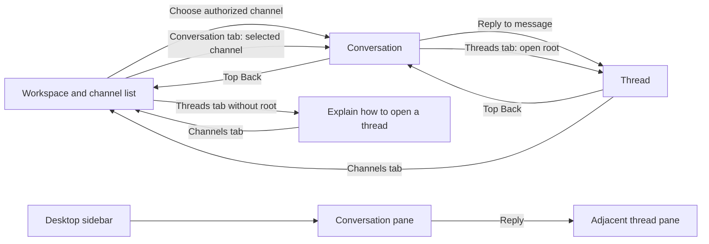
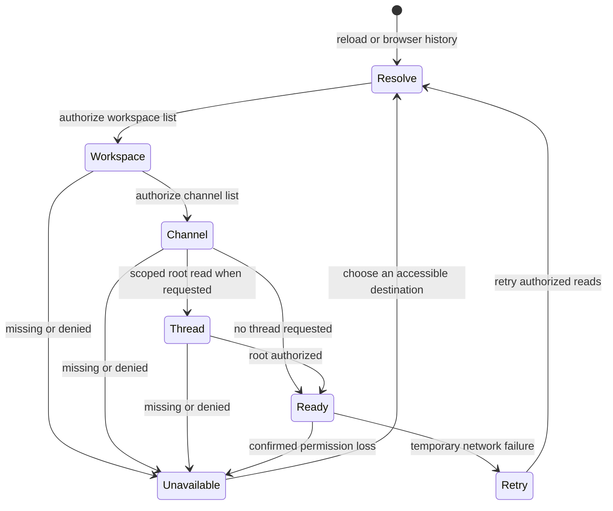

# Mobile navigation decisions (#25 / #32)

This slice uses Channels, Conversation and Threads tabs below 640px. Desktop
retains the workspace sidebar and simultaneous conversation/thread panes.
DMs, full search and personal triage remain gated by their owning epics.
No PAS provisioning or authorization changes are introduced.

Flow: Channels -> select authorized channel -> Conversation -> reply -> Thread.
Back: Thread -> Conversation -> Channels. Bottom tabs can jump between views.
Threads without an open root explains how to open one. Members, mentions and
settings open in the content view; bottom tabs return to channel content.

Tabs and the top back arrow preserve mounted conversation/reply drafts and
scroll positions. Selecting another channel/workspace, losing membership or
signing out discards private context as before. Nothing private is persisted
in URLs or storage. Without a valid link, refresh starts from the authorized workspace/channel list.
Browser Back/Forward restores identifier selections through authorized reads. It does
not intercept OS navigation or guarantee exit to a home screen. Refresh restores
an authorized URL selection, but never restores private drafts or scroll offsets.
See the restoration contract below for unavailable resources.

The shell is a viewport-height flex column with non-scrolling bars. Middle
panes scroll; message lists fill remaining pane height. Safe-area insets belong
to the bars, avoiding duplicate root padding. Chrome can resize content for the
keyboard via interactive-widget; dvh responds to dynamic viewport sizing.
Actual keyboard behavior, iOS splash appearance and installed PWA chrome still
require a real phone review and cannot be proved by desktop viewport resizing.

Review coverage: Playwright checks 375px navigation, one visible pane, clipped
skip link/focus activation, current-user profile, back behavior, draft retention,
viewport shrink, and 200% root text reflow. Controls retain 2.75rem minimum height.
Review 320px and 400% text separately, landscape and touch targets on real devices;
verify reachable composers and no horizontal overflow. Test permission loss while
away in another tab, temporary outages, and server-authorized unavailable roots.
Production mobile screenshots must distinguish mocked transport from real sessions.

Run the mobile browser checks against deployed assets with SLACKIE_BASE_URL set
to the production origin and pnpm test:browser --grep "skip link|mobile". These
checks mock PAS responses and never write production records. Leave the variable
unset for the local full suite. The screenshot at 375x480 also checks that the
send button remains in view after viewport shrink.

## E14 link restoration update (2026-10-21)

The previous reload/deep-link limitation is superseded by query parameters
`workspace`, `channel` and optional `thread`. URLs carry identifiers only; workspace
and channel lists and scoped thread-root reads reauthorize before content appears.
Unknown/revoked identifiers show generic unavailable states. Native browser back
restores selection through those reads. No message bodies, names or drafts enter
the URL or persistent storage. Mobile tab/back view changes preserve mounted
private drafts; channel/workspace changes and confirmed revocation discard them.
DOM regressions cover restoration, denied identifiers, browser back and polling
while on the channel-list tab. Real phone/zoom review remains outstanding.

## Navigation flow and state diagrams

Below 640 CSS pixels, the workspace/channel list is its own full-screen view;
conversation and thread are separate full-screen views with persistent top/back
and bottom navigation. At 640px and above, the sidebar and conversation appear
together; an open thread adds a pane. Resizing keeps the selected resources and
mounted drafts. Members, mentions and authorized settings are content destinations,
not additional global tabs. DMs (E11), full search (E12) and personal triage/You
(E11) remain future states, gated by their owning epics; no enabled MVP entry
points or implied availability may be added.

Tabs change the visible mobile pane without adding a URL history entry. Top Back
changes the pane in the order shown and retains the open thread. Closing a thread
removes its root from the URL and unmounts its reply draft. Browser Back/Forward
traverses resource selections, not every tab or top-back press. Selecting a
workspace clears channel/thread context before resolving its authorized channels.
With no channel selected, Conversation explains that selection is required;
Threads without a root explains how to open one.

## Restoration, privacy and recovery contract

| Event | Selection and visible state | Draft and scroll treatment |
| --- | --- | --- |
| Tab/top Back within selected channel | Reveal mounted pane; no new history entry | Keep both drafts and pane scroll positions |
| Channel or workspace change | Resolve authorized destination; clear old thread | Discard previous private drafts and scroll context |
| Open/close or change thread root | Authorize root within current channel | New root gets a fresh reply draft; close discards it |
| Reload or direct link | Parse identifier-only workspace/channel/thread query; authorize each level before rendering | No persisted drafts or scroll positions; start fresh |
| Browser Back/Forward | Reauthorize URL identifiers; never silently substitute an inaccessible requested ID | Changed resources get fresh private context |
| Confirmed 401/403 or membership revocation | Clear private content and show access recovery, including while another pane is visible | Clear drafts, thread and queued announcements |
| Temporary outage or rate limit | Show retry state; do not treat transport failure as revocation | Retain current in-memory draft for retry/copy |
| Sign out | Remove authenticated content | Discard all mounted private state |

A link is a request, never an authorization grant. Missing/revoked workspace,
channel or root produces a generic unavailable response without disclosing names
or bodies. An unavailable root must not fetch replies. Invalid/malformed links
fall back to normal authorized navigation. Invite query parameters are preserved.
URLs and storage must never contain message bodies, names or drafts. Preferences
may persist independently; no PAS resources or provisioning are required.

## Narrow viewport, touch and zoom/reflow review plan

For each row, record browser/OS/device, viewport, zoom, input method, result and
screenshots; a failure needs an owner and follow-up before build-ready approval.
Use an authorized test account with long history, long channel names, empty lists,
an open thread and unsent drafts. Avoid production writes for mocked checks.

| Review | Procedure and pass condition | Evidence status |
| --- | --- | --- |
| Narrow portrait | 320, 375 and 390 CSS px: list → conversation → thread → Back; exactly one content pane, reachable bars/composers, no document horizontal scroll | Existing 375px browser checks; 320/390 manual review pending |
| Landscape and keyboard | Real iOS Safari and Android Chrome; rotate, open keyboard, type in both composers, dismiss and reopen | Pending real devices; send and navigation must remain reachable, drafts retained |
| Touch targets | Measure every interactive navigation, back, workspace selector and composer control; at least 44×44 CSS px, with spacing preventing adjacent activation | Pending measurement; existing 2.75rem minimum height alone is insufficient evidence |
| 200% browser zoom | Desktop 1280px viewport at 200%; complete the same flow by keyboard without clipping, overlap or lost content | Pending browser zoom review; existing 200% root-font test is supporting evidence only |
| 400% browser zoom/reflow | Desktop 1280px viewport at 400% (320 CSS px equivalent); content reflows into one pane, no two-dimensional document scrolling, all actions reachable | Pending manual zoom review; root-font scaling does not replace browser zoom |
| Restoration | Paste/reload authorized channel and thread URLs, then Back/Forward; repeat with missing IDs and revoked membership | Existing DOM tests; real-session review pending |
| Privacy and recovery | Draft in both panes, switch tabs, revoke permission elsewhere, return; then repeat with a temporary outage | DOM tests cover revocation/draft retention; real-session review pending |
| Desktop panes | At 640, 1024 and 1440 CSS px verify sidebar, conversation and thread, then resize to mobile and back | Existing desktop/mobile browser checks; boundary and device review pending |

## Navigation decision and review record (2026-10-22)

Repository review for #25 compared App.tsx, Channels.tsx, Conversation.tsx,
ThreadPanel.tsx, navigation.ts and experience.ts with existing DOM and browser
regressions. Decisions: independent mobile panes; resource-based URL history;
in-memory private drafts; authorization before linked content; future epic gates.
The diagrams and recovery table above are the recorded design contract. The
review found the previous text incorrectly described URL restoration as future
work; that obsolete description has been removed.

This is a repository design consistency review, not a real-device usability or
assistive-technology sign-off. The matrix explicitly records remaining manual
evidence. No build-ready child tasks are approved or created by this document.
Before creating such tasks, the product/design owner must record reviewer, date,
results for the matrix, unresolved findings and an explicit approval decision here.
The gate remains pending until that record exists. Parent E14 manual acceptance
stays open. docs/research-foundations.md is preserved; PAS constraints are unchanged.

Validation for this revision: `pnpm test` passed (791 SQL assertions, 37 unit/DOM
tests and contrast checks), including new reload-without-drafts and stale-thread
URL regressions. Browser execution was attempted but blocked before test bodies:
the Playwright browser was absent, installation rejects macOS 12, and installed
Chrome aborts on a missing VideoToolbox symbol. No browser or manual review pass
is claimed for this revision. This completes the #25 design specification and
review plan; the approval gate and parent epic evidence remain pending as above.

## Issue #32 implementation and acceptance

The mobile shell reuses the authorized navigation and draft restoration above.
Its bottom destinations are Channels, Conversation, Threads and You (profile),
matching the functionality currently available; DMs are not yet implemented.
The top title follows workspace/channel/thread context. Preferences live on the
Channels screen on mobile so they do not consume conversation height.

At normal zoom the shell tracks `visualViewport.height` and `offsetTop` to keep
both bars and the composer inside the visible keyboard viewport, including iOS
viewport panning. Pinch zoom retains native browser behavior. Safe-area padding
covers all four edges; message history scrolls independently. Reduced motion
removes the view entrance animation. The skip link remains clipped until focus.
The standalone manifest and Apple installation metadata provide the installed
name, theme/background colors and icons used by OS-generated launch screens.

Regression coverage includes viewport resize/pan, pinch zoom, listener cleanup,
profile opening without discarding a draft, fixed-bar geometry, long histories,
keyboard-sized viewports, enlarged text and screenshots in `test-results/`.
A desktop mobile viewport does not establish installed-phone acceptance. For
installed-phone acceptance, review the deployed PWA on real iOS and Android phones: installation,
launch/splash, notches, portrait/landscape, keyboard opening/closing, profile,
thread navigation and draft retention. Record device/OS and screenshots.

On the macOS 12 development host, current Chrome cannot launch. Browser checks
can run using an isolated Chrome for Testing 131 headless binary via
`SLACKIE_BROWSER=/path/to/chrome-headless-shell pnpm test:browser`. Deployment
checks use the workflow's supported Linux Chromium. Neither replaces real-device
review of the installed PWA.

Validation on 2026-10-22: `pnpm test` passed 791 SQL assertions, 47 unit/DOM tests,
TypeScript and contrast checks; `pnpm build` passed platform compliance and PWA
build; the complete browser suite passed all 51 tests using Chrome for Testing
131. Mocked-PAS viewport evidence: [375×812 conversation](screenshots/mobile-conversation.png)
and [375×480 keyboard-height layout](screenshots/mobile-keyboard-height.png).
These screenshots show local test fixtures, not an authenticated phone session.
